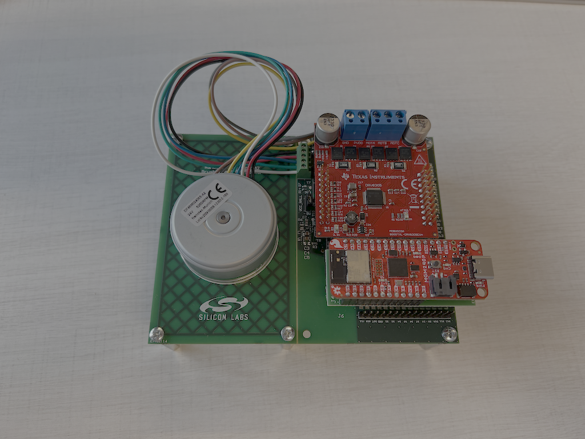
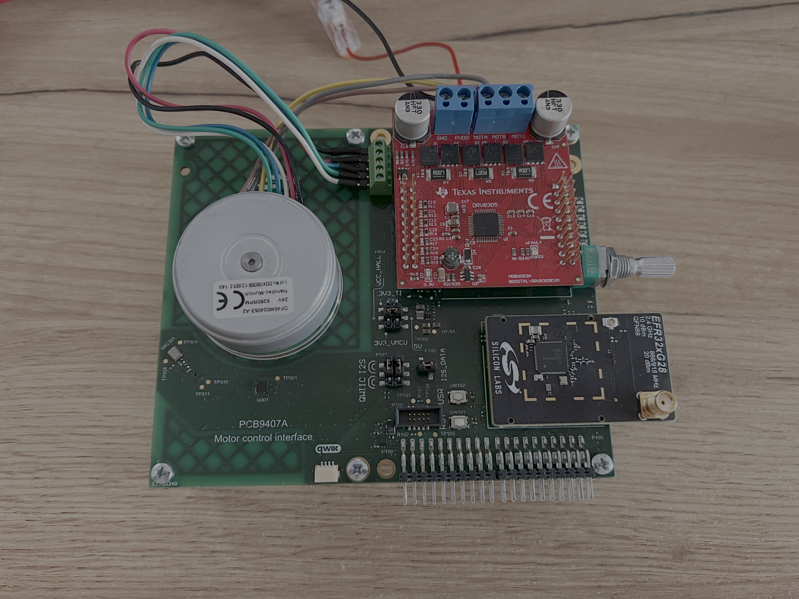

# SimpleFOC Port for Silicon Labs SDK
This repository contains a hardware abstraction layer (HAL) port of the SimpleFOC motor control library for Silicon Labs SDK (SiSDK), with specific support for the following development boards:
- SparkFun Thing Plus Matter MGM240P
- BRD4186C
- BRD4401C

## Hardware requirements
* **Motor Control Interface Board** *(V1 with conversion board for Thing PLus Matter, V2 for Silabs radio boards)*
* **Supported development board**:
   * **[SparkFun Thing Plus Matter](https://www.sparkfun.com/sparkfun-thing-plus-matter-mgm240p.html)**
   * **[BRD4186C](https://www.silabs.com/development-tools/wireless/xg24-rb4186c-efr32xg24-wireless-gecko-radio-board?tab=overview)**
   * **[BRD4401C](https://www.silabs.com/development-tools/wireless/xg28-rb4401c-efr32xg28-2-4-ghz-ble-and-20-dbm-radio-board?tab=overview)**
* **[DRV8305 BoosterPack (BOOSTXL-DRV8305EVM)](https://www.ti.com/tool/BOOSTXL-DRV8305EVM)**
* **BLDC Motor: [DF45M024053 – A2](https://www.nanotec.com/eu/en/products/1789-df45m024053-a2)**
* USB cable for programming and serial monitor
* WSTK is required for programming the V2 interface board

## Hardware Setup
A dedicated interface board setup connecting the Motor - Power Stage - development board. Jump wires can be used as well to connect the boards.

 

Wiring for the supported boards are available in the `projects/project_name/readme.md`:
- [Sparkfun Thing Plus Matter](projects/simplefoc-port-thingplusmatter/readme.md)
- [BRD4186C](projects/simplefoc-port-brd4186c/readme.md)
- [BRD4401C](projects/simplefoc-port-brd4401c/readme.md)


## Build
Build system dependency (these are installed if Simplicity Studio is installed):
 - CMake (v3.25 or newer)
 - Ninja (v1.10 or newer)
 - ARM GCC compiler (v12.2 or newer)
 - Make (optionally to run the utility scripts)

All submodules should be initialized and updated before building. *(recommended to use `git submodule update --init --recursive`)*

### Build with Make
To build every binary you shall run (in the root folder)
```shell
make
```

The following build targets are available:
- `all`  
   Builds all firmware components. This is the default target.
- `simplefoc-port-thingplusmatter`  
   Builds the simpleFOC port firmware for Sparkfun Thing Plus Matter board.
- `simplefoc-port-brd4186c`  
   Builds the simpleFOC port firmware for BRD4186C board.
- `simplefoc-port-brd4401c`  
   Builds the simpleFOC port firmware for BRD4401C board.
- `clean`  
   Cleans all build artifacts from firmware components.

*Note: The build can be found under the `projects/project_name/cmake_gcc/build/base` folder.*

The following arguments can be added:
 - `TARGET`  
   Specifies the build operation.  
   Options: `clean_build`, `clean`, `configure`, or `build`.  
    - `clean_build` performs clean, configure, and build in sequence (default).  
    - `build` performs incremental build (requires prior configure step).  
    - `configure` sets up build system without building.  
    - `clean` removes build artifacts.
 - `TYPE`  
   Build configuration type.  
   Options: `Debug` (default) or `Release`.  
   Currently not supported.

Examples:
```shell
make simplefoc-port-brd4186c TARGET=build TYPE=Release
make simplefoc-port-thingplusmatter TARGET=clean_build
make all
```

### Build with Docker
Dockerfile is also present in the root folder, to use it the following shall be done:
 1. Install Docker: https://docs.docker.com/engine/install/
 2. Build a docker image. (Default platform is x86_64.)  
    `docker build . -t simplefoc-port-build-env:latest`  
    You can also use the Makefile to do this operation. This can also recognize Apple Silicon (aarch64).  
    `make docker_image`  
 3. Build the image  
    `docker run --rm -v .:/home -w /home simplefoc-port-build-env:latest /bin/sh -c "make all"`  
    With Makefile:  
    `make docker_build`  

## Flashing the development board
Can be flashed on any host with Simplicity Commander (or with any compatible ARM debugger).
Simplicity Commander guide: https://www.silabs.com/documents/public/user-guides/ug162-simplicity-commander-reference-guide.pdf

## Contributing
Please follow the [CONTRIBUTING](./.github/CONTRIBUTING.md) guideline.

## License
See the [LICENSE.md](./LICENSE.md) file for details.
