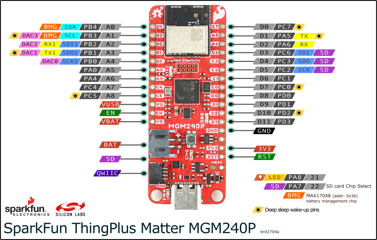

# SimpleFOC Sparkfun Thing Plus Matter port
This repository contains a hardware abstraction layer (HAL) port of the SimpleFOC motor control library for Silicon Labs SDK (SiSDK), with specific support for the SparkFun Thing Plus Matter MGM240P development board.

### Examples
3 examples are included:
- Open-loop velocity 6PWM
- Hall-sensor velocity 6PWM
- Torque velocity 6PWM (current sense)

The examples can be selected in the `device_config.h` file with the modification of the **APPLICATION_EXAMPLE** define.
*Note: The **EXAMPLE_CUSTOM** option lets the user create their own example using the `motor_control.cpp` as the base file.*

### Wiring
Connect the SparkFun Thing Plus Matter board to the DRV8305EVM according to the board pin mapping (phase outputs, PWM inputs, and Hall sensor connections).

### Wiring Table: SparkFun Thing Plus Matter to BOOSTXL-DRV8305 & BLDC Motor

This table describes the connections between the SparkFun Thing Plus Matter, the TI BOOSTXL-DRV8305 driver board, and a 3-phase BLDC motor with Hall sensors.

| From (SparkFun Thing Plus Matter) | To (DRV8305 BoosterPack Pin) | BLDC MOTOR | Function / Description |
| :--- | :--- | :--- | :---|
| `3.3V` | `3V3` | HALL/ENC Supply*  | 3.3V Power; the BoosterPack provides 3.3V through an LDO |
| `GND`  | `PowerSupply GND` | HALL/ENC sensor GND | Common Ground |
| N/A    | `PowerSupply 24V` | N/A | Power supply for power stage 4.4 to 45 V, consider motor power|
| `A0`   | `VSENC` | N/A | Phase C Voltage sense (Optional, not mandatory to run examples) |
| `A1`   | `VSENB` | N/A | Phase B Voltage sense (Optional, not mandatory to run examples) |
| `A2`   | `VSENA` | N/A | Phase A Voltage sense (Optional, not mandatory to run examples) |
| `A3`   | `ISENC` | N/A | Phase C current sense |
| `A4`   | `ISENB` | N/A | Phase B current sense |
| `A5`   | `ISENA` | N/A | Phase A current sense |
| `A6`   | `VSENVPVDD`   | N/A | DC BUS Voltage sense (Optional, not mandatory to run examples)|
| `A7`   | N/A | N/A | N/A|
| `A8`   | `nFAULT` | N/A | Fault indicator, specific FAULT status can be obtained through the status registers |
| `D0`   | N/A | HALL B or Encoder B | Motor sensor connection (Hall configuration in examples) |
| `D1`   | N/A | N/A | N/A |
| `D2`   | N/A | N/A | N/A |
| `D3`   | N/A | HALL A or Encoder A | Motor sensor connection (Hall configuration in examples) |
| `D4`   | `PWMHA` | N/A | PWM Phase A High-Side Gate Signal |
| `D5`   | `PWMLA` | N/A | PWM Phase A Low-Side Gate Signal |
| `D6`   | `PWMHB` | N/A | PWM Phase B High-Side Gate Signal |
| `D7`   | `PWMLB` | N/A | PWM Phase B Low-Side Gate Signal |
| `D8`   | `PWMHC` | N/A | PWM Phase C High-Side Gate Signal |
| `D9`   | `PWMLC` | N/A | PWM Phase C Low-Side Gate Signal |
| `D10`  | `ENGATE` | N/A | Enable DRV8305 gate driver |
| `D11`  | N/A | HALL C or Encoder Index | Motor sensor connection (Hall configuration in examples) |
| N/A    | `PHASE U` | `PHASE U` | Motor phase connection |
| N/A    | `PHASE V` | `PHASE V` | Motor phase connection |
| N/A    | `PHASE W` | `PHASE W` | Motor phase connection |

**Important Notes:**
*   **Power:** Ensure the DRV8305's `PVDD` and `GVDD` jumpers are correctly set for your motor's voltage. The power supply should be rated at least twice the motor’s nominal power. The BoosterPack can supply the SparkFun Thing Plus Matter if it is not connected to USB.
* **Rotor sensor:** Some Encoder or Hall sensors might require 5V supply, ensure proper level shifting if required.

---
